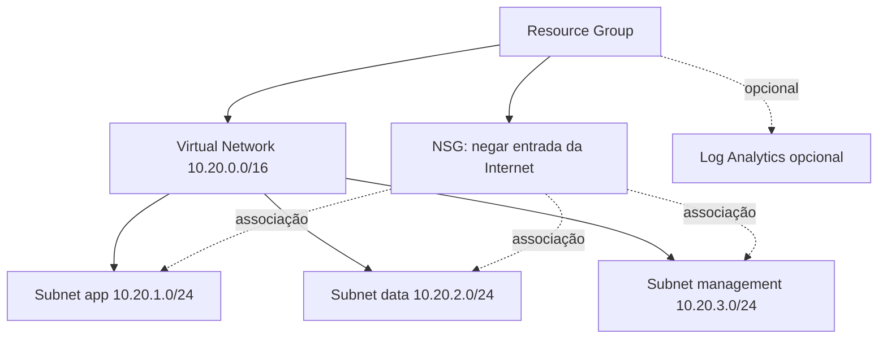

# Azure Secure Infrastructure — Terraform

Projeto de Infraestrutura como Código para criar uma base de rede Azure segmentada, versionável e com regras de entrada explícitas. Foi planejado para aprendizado e revisão de código; **não foi aplicado em uma assinatura Azure**.

> **Custo e segurança:** o padrão cria um Resource Group, VNet, três subnets e um Network Security Group. Não cria máquinas virtuais, IPs públicos, NAT Gateway ou firewall gerenciado. O Log Analytics é opcional e fica desligado por padrão. Qualquer aplicação real deve revisar arquitetura, custos, região e requisitos antes de `terraform apply`.

## Arquitetura



## Recursos e decisões

- **Segmentação:** subnets separadas para aplicação, dados e administração.
- **NSG:** regra explícita para negar tráfego de entrada com origem na tag de serviço `Internet`; regras padrão do Azure continuam valendo para o tráfego interno de VNet.
- **Sem entrada administrativa pública:** não são criadas regras de entrada para SSH/RDP e não existe IP público.
- **Sem acesso de saída padrão nas subnets:** `default_outbound_access_enabled = false`; planeje NAT Gateway/Azure Firewall e regras de saída antes de implantar workloads que necessitem de egress.
- **Telemetria opcional:** Log Analytics pode ser habilitado por variável; ingestão e retenção podem gerar custos.
- **Sem credenciais no código:** use Azure CLI ou identidade federada e nunca comite segredos/estado Terraform.

## Pré-requisitos

- Terraform compatível com `required_version` em `versions.tf`.
- Azure CLI, sessão autorizada e assinatura selecionada para `plan`/`apply`.
- Permissões Azure adequadas para criar os recursos declarados.

## Validar localmente (não cria recursos)

```bash
terraform fmt -recursive
terraform init -backend=false
terraform validate
```

No PowerShell, os mesmos comandos Terraform funcionam se o binário estiver no `PATH`. Para validar a proposta de alterações com Azure autenticado:

```bash
az login
az account show
terraform plan -out=tfplan
```

Revise o plano, a região, a política de rede e os custos antes de decidir se deve aplicar. **Não execute `terraform apply` sem revisar o plano e confirmar a assinatura/ambiente.** Um `plan` pode precisar de autenticação Azure; `init`/`validate` não aplicam recursos.

Exemplo de configuração: copie `terraform.tfvars.example` para `terraform.tfvars` e ajuste os nomes/CIDRs para evitar conflito com a rede existente. `terraform.tfvars` é ignorado pelo Git.

## CI do GitHub

O workflow `.github/workflows/terraform-validate.yml` executa `fmt`, `init -backend=false` e `validate` em pull requests/pushes. Ele não faz login no Azure nem provisiona recursos.

## Limitações

- Este repositório é uma base demonstrativa, não uma landing zone corporativa completa.
- Não implementa conectividade híbrida, VPN, DNS privado, firewall central, Azure Policy, RBAC de usuário ou backend remoto do state.
- O NSG é uma camada de filtragem L3/L4; a segurança de aplicação exige controles adicionais.
- A criação real não foi executada nesta entrega. A validação final do provider e do plano deve ocorrer no seu ambiente com Terraform instalado e acesso Azure.

## Licença

MIT — veja [LICENSE](LICENSE).
